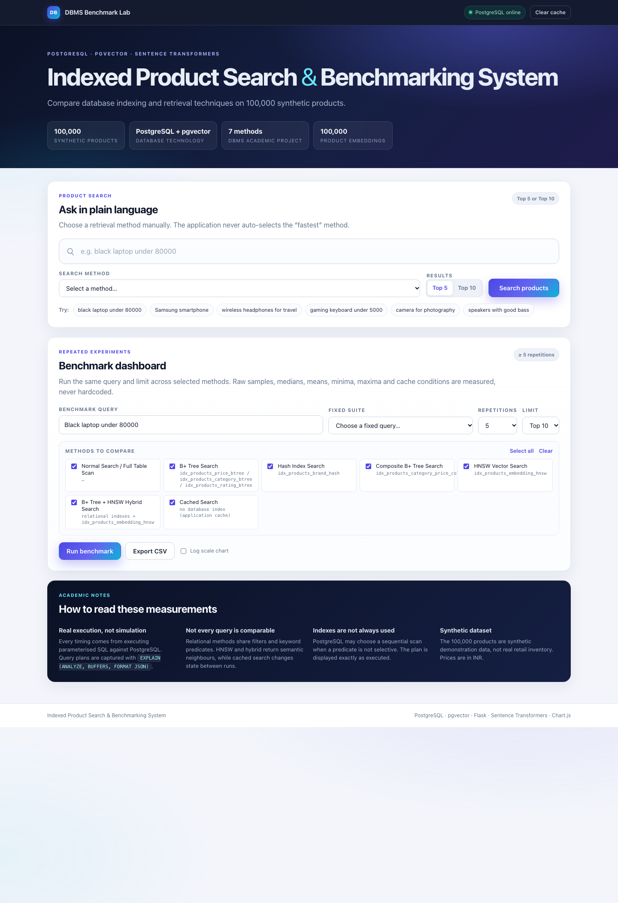

# Indexed Product Search & Database Performance Benchmarking System

**Product Search Engine: A Comparative Study of Database Indexing Techniques**

A full-stack DBMS academic project that compares seven database search and retrieval
techniques on exactly **100,000 synthetic products** using **PostgreSQL**, **pgvector**,
**Sentence Transformers**, **Flask**, and **Chart.js**.

The application is a working natural-language product-search interface with a simple
analysis page. Every timing shown in the UI comes from executing real parameterised SQL
against PostgreSQL; query plans come from `EXPLAIN (ANALYZE, BUFFERS, FORMAT JSON)`.



## What is implemented

| Requirement | Status |
|---|---|
| 100,000-row dataset validation | Implemented; report at `docs/validation_report.md` |
| PostgreSQL schema + constraints | Implemented |
| pgvector + 384-dimensional embeddings | 100,000 real embeddings generated |
| HNSW vector index | Built (`m=16`, `ef_construction=64`) |
| Seven separately selectable methods | Implemented and tested |
| Natural-language parser | Categories, brands, colours, prices, use cases, keywords |
| Flask API | Search, benchmark, health, cache, CSV export |
| Frontend | Responsive search + simple analysis dashboard with Chart.js |
| Repeated benchmark experiments | ≥ 5 repetitions, raw samples, statistics (API) |
| Query-plan inspection | `EXPLAIN` available through the API and test suite |
| CSV export | Per-run API export + fixed-suite CSV |
| Pytest suite | 101 tests passing against the real database |
| Documentation | README, setup, architecture, API, methods, methodology, report |

## Seven search methods

1. **Full Table Scan** — sequential-scan baseline with index and bitmap scans
   deliberately disabled for the measurement.
2. **B+ Tree** — PostgreSQL B-tree indexes on `price_inr`, `category`, and `rating`;
   equality and range predicates. The planner chooses the actual index.
3. **Hash Index** — PostgreSQL hash index on `brand`; equality only. Queries without
   a brand explicitly report that the hash index is not applicable.
4. **Composite Index** — multicolumn B-tree on `(category, price_inr, color)`;
   demonstrates the leading-column rule and orders results along the index columns.
5. **HNSW Vector Search** — cosine-distance approximate nearest-neighbour search
   over real Sentence Transformers embeddings.
6. **Hybrid (Filters + Vector)** — structured SQL filters combined with semantic
   ranking, using iterative HNSW scanning when filters are selective. The actual plan
   shows which indexes PostgreSQL used.
7. **Cached Search** — application-level TTL/LRU cache in front of hybrid search;
   demonstrates cache miss, hit, repeated queries, clearing, and separate hit timing.

The user must manually select the search method. The application never auto-selects
the “fastest” method.

### Scope behaviour

A query is answered only when it is in scope for the catalogue: it names a category or
brand, or every keyword has a word-boundary match in the product text (synonyms are
allowed). Colour and price on their own are refinements, not scope. Out-of-scope
queries return **zero products** without a database search, so unrelated prompts never
receive arbitrary nearest neighbours.

Interactive searches also run a single SQL statement (`include_plan: false`), so a
second hidden `EXPLAIN` execution cannot distort repeated timings.

## Technology stack

- **Frontend:** HTML, CSS, JavaScript, Chart.js 4.4.7 (vendored locally)
- **Backend:** Python 3.12, Flask 3.1
- **Database:** PostgreSQL 19 (Postgres.app build), pgvector 0.8.7
- **Embeddings:** `sentence-transformers/all-MiniLM-L6-v2` (384 dimensions, local CPU)
- **Data processing:** pandas, NumPy
- **Testing:** pytest
- **Cache:** in-process TTL + LRU cache (no Redis required)
- **Cost:** entirely free and open source; no paid APIs, hosting, or cloud services

## Project structure

```text
dbms_2/
├── app/
│   ├── __init__.py              # Flask application factory
│   ├── config.py                # Environment-driven configuration
│   ├── db.py                    # psycopg connection pool + parameterised helpers
│   ├── query_parser.py          # Rule-based natural-language parser
│   ├── embeddings.py            # Sentence Transformers service
│   ├── cache.py                 # Thread-safe TTL/LRU application cache
│   ├── plan.py                  # EXPLAIN JSON parser
│   ├── benchmark.py             # Repetition runner, statistics, CSV
│   ├── routes.py                # API endpoints
│   └── search/
│       ├── __init__.py          # Dispatcher and response assembly
│       ├── base.py              # Shared SQL/execution helpers
│       ├── full_scan.py         # Method 1
│       ├── btree.py             # Method 2
│       ├── hash_index.py        # Method 3
│       ├── composite_btree.py   # Method 4
│       ├── hnsw.py              # Method 5
│       ├── hybrid.py            # Method 6
│       └── cached.py            # Method 7
├── templates/
│   ├── index.html               # Search page
│   └── analysis.html            # Analysis dashboard
├── static/
│   ├── css/style.css
│   ├── js/app.js
│   ├── js/analysis.js
│   └── vendor/chart.umd.min.js
├── scripts/
│   ├── schema.sql
│   ├── validate_dataset.py
│   ├── init_db.py
│   ├── import_data.py
│   ├── generate_embeddings.py
│   ├── run_benchmarks.py
│   ├── start_postgres.sh
│   └── stop_postgres.sh
├── tests/                       # 101 pytest tests
├── data/                        # Validation and benchmark JSON
├── docs/                        # Reports, guides, CSV, screenshots
├── synthetic_products_100000.csv
├── requirements.txt
├── .env.example
├── pytest.ini
└── run.py
```

## Quick start (this machine)

The project is already initialised and the database contains 100,000 products and
100,000 embeddings. Start the local database and the web application:

```bash
# 1. Start PostgreSQL on port 5433 (data directory: .pgdata)
bash scripts/start_postgres.sh

# 2. Activate the prepared environment
source .venv/bin/activate

# 3. Start Flask
python run.py
```

Open **http://127.0.0.1:5001**.

The PostgreSQL binaries used here are from the free Postgres.app installation at
`~/Applications/Postgres.app/Contents/Versions/19/bin`. The helper script uses that
path by default; set `PGBIN` if PostgreSQL is installed elsewhere.

## Full setup from scratch

Requirements: Python 3.11/3.12, PostgreSQL 16+ with the pgvector extension, and
~1 GB of free disk space (dataset, table, embeddings, and HNSW index).

```bash
# Python environment
python3 -m venv .venv
source .venv/bin/activate
pip install -r requirements.txt
cp .env.example .env

# PostgreSQL (Postgres.app on macOS includes pgvector)
bash scripts/start_postgres.sh

# Validate the original CSV without modifying it
python scripts/validate_dataset.py

# Create schema, pgvector extension, and relational indexes
python scripts/init_db.py

# Bulk import all 100,000 rows with COPY
python scripts/import_data.py

# Generate 100,000 real embeddings and build the HNSW index
python scripts/generate_embeddings.py

# Run the fixed benchmark suite and write docs/benchmark_results.csv
python scripts/run_benchmarks.py --repetitions 5 --limit 10

# Start the app
python run.py
```

The first embedding run downloads the free `all-MiniLM-L6-v2` model from Hugging
Face and caches it locally. No API key is required.

### Rebuilding the database

`python scripts/init_db.py` drops and recreates the `products` table, so embeddings
must be regenerated afterwards:

```bash
python scripts/init_db.py
python scripts/import_data.py
python scripts/generate_embeddings.py
python scripts/run_benchmarks.py
```

## API summary

| Endpoint | Purpose |
|---|---|
| `POST /api/search` | Run one of the seven methods |
| `POST /api/benchmark` | Repeated measurements + statistics |
| `POST /api/benchmark/export` | Run a benchmark and download CSV |
| `GET /api/benchmark/suite` | Fixed seven-query suite |
| `GET /api/benchmark/results.csv` | Generated fixed-suite CSV |
| `GET /api/health` | App/database/dataset/embedding/index health |
| `GET /api/methods` | Method metadata |
| `GET /api/cache/stats` | Cache statistics |
| `POST /api/cache/clear` | Clear/invalidate the cache |
| `GET /api/products/<id>` | One product record |

Example:

```bash
curl -X POST http://127.0.0.1:5001/api/search \
  -H 'Content-Type: application/json' \
  -d '{"query":"black laptop under 80000","method":"composite_btree","limit":10}'
```

Full request/response documentation: `docs/api.md`.

## Benchmarks

The benchmark API is retained for academic measurement. Fixed-suite results are
stored in `docs/benchmark_results.csv` and summarised in
`docs/benchmark_summary.md`; methodology is in `docs/benchmark_methodology.md`.
The interactive UI focuses on the latest real database time per method on the
**Analysis** page rather than a full benchmark dashboard.

Representative warm timings on this machine (Top 5, `include_plan: false`):

| Method | Typical DB execution time |
|---|---:|
| Full Table Scan | ~9.4–10.7 ms |
| B+ Tree | ~1.2 ms |
| Hash Index (brand present) | ~0.6–1.2 ms |
| Composite Index | ~0.57 ms |
| HNSW Vector Search | ~1.4–1.8 ms |
| Hybrid (Filters + Vector) | ~1.4–1.6 ms |
| Cached Search | 0 ms on a hit |

These are actual measurements, not hardcoded values. HNSW/hybrid database times
exclude query-embedding time. Repeated identical searches are stable because the
interactive path runs one query and performs no plan capture.

## Query-specific analysis page

Each query gets a stable query ID. Running the same query with another method adds
that method to the same query's graph; changing the query creates a new graph. The
`/analysis` page lists every saved query below the graph, and tapping a query ID
reopens its chart and method table. Everything is stored only in the browser's
`localStorage`; nothing is sent to a server.

## Testing

```bash
source .venv/bin/activate
pytest -q
```

Result on this machine: **101 passed**. The suite exercises the real database:
dataset integrity, all seven methods, parser and scope behaviour, result limits, invalid
requests, SQL parameterisation/injection safety, cache hit/miss/clear/TTL/LRU,
vector and hybrid search, benchmark statistics, CSV export, and API errors.

See `docs/testing.md`.

## Documentation

- `docs/installation.md` — full installation and execution guide
- `docs/database_setup.md` — schema, import, indexes, verification
- `docs/architecture.md` — system architecture and request flow
- `docs/api.md` — API reference
- `docs/search_methods.md` — seven methods and observed plans
- `docs/benchmark_methodology.md` — measurement methodology and validity
- `docs/testing.md` — test plan and results
- `docs/validation_report.md` — dataset validation
- `docs/benchmark_summary.md` — fixed-suite summary
- `docs/benchmark_results.csv` — raw fixed-suite samples
- `docs/report.md` — full academic report with actual results
- `docs/presentation_guide.md` — idea-to-final presentation guide, demo script,
  three-person work division, viva Q&A, setup, and glossary
- `docs/20_minute_presentation_script.md` — timed 20-minute, three-member speaking
  script with demo cues, viva answers, and failure recovery
- `docs/curated_demo_queries.md` — one demo query per index with the actual plan,
  measured median, verdict, and the sentence to say
- `docs/demo_query_results.json` — raw measured evidence behind every demo claim
- `docs/DBMS_Index_Project_Presentation.pptx` — 18-slide deck with speaker notes
- `docs/screenshots/` — application screenshots

## Dataset

`synthetic_products_100000.csv` contains exactly 100,000 synthetic products:
10 categories × 10,000 products, 45 brands, 7 colours, prices in INR, ratings
2.8–5.0, and stock 0–150. Product IDs range from `P000001` to `P100000`.
The original file is never modified; imports use UTF-8 BOM handling. Names are
intentionally non-unique; the primary key is `product_id`.

This is synthetic demonstration data, **not real retail inventory**.

## Known limitations

- The embedding model runs on CPU; the first semantic request in a fresh process
  may pay a one-time model-loading cost (the app warms the model in the background).
- HNSW is approximate; recall depends on `ef_search` and index parameters.
- Relational keyword search uses `ILIKE` and practical synonym expansion, but there
  is no keyword relaxation: one search executes one query. Semantic methods handle
  unseen vocabulary better.
- PostgreSQL’s planner may choose a different index than the method’s “expected”
  index. The actual plan is available through the API and test suite; no index usage
  is claimed without evidence.
- Out-of-scope queries are rejected before the database query so unrelated prompts
  return nothing. The scope check itself scans the product text and is cached briefly
  in-process.
- Cold-start measurements are not forced by restarting PostgreSQL; the benchmark
  uses one unmeasured warm-up run and reports cache conditions.
- Product images are intentionally postponed; `image_key` and `image_prompt` are
  preserved for future integration.
- Redis is optional and not required; the application cache is in-process and is
  therefore not shared across multiple Flask worker processes.
